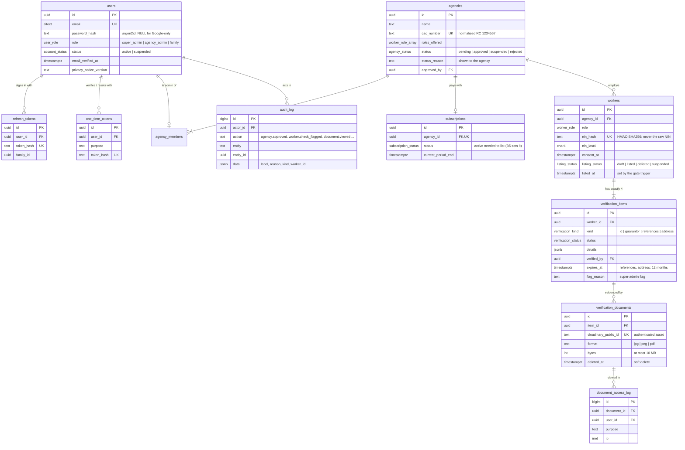

# Database

PostgreSQL 16. Migrations in `apps/api/app/db/migrations/versions/`, with readable SQL copies in `apps/api/app/db/sql/`. Conventions and the full planned schema are in `.claude/skills/helpverified/references/database.md`. This file shows **what exists now** and is updated with every migration.

| Migration | Milestone | Adds |
| --- | --- | --- |
| `0001` baseline | B1 | Extensions `pgcrypto` and `citext`; `set_updated_at()` trigger function |
| `0002` identity | B2 | `user_role`, `account_status` enums; `users`, `refresh_tokens`, `one_time_tokens` |
| `0003` agencies, workers | B3 | Six enums; `agencies`, `agency_members`, `subscriptions`, `workers`, `verification_items`, `verification_documents`, `document_access_log`, `audit_log`; **rule 1 triggers** |

## Entity-relationship diagram

## Rules enforced in the database

| Rule | How |
| --- | --- |
| **Rule 1: listed only with 4/4 checks verified and unexpired** | `workers_listing_gate` (BEFORE INSERT/UPDATE OF listing_status) raises `P0001`, hint `WORKER_NOT_VERIFIED`; the repository maps it to 409 |
| **Any check leaving `verified` delists the worker** | `verification_items_delist` (AFTER UPDATE OF status); active placements are not ended |
| One worker per NIN, across agencies | `uq_workers_nin_hash` (409 `DUPLICATE_WORKER`) |
| Exactly one row per check per worker | `uq_verification_items_worker_id_kind`; the four rows are created with the worker |
| A verified check names who verified it and when; a rejected one has a reason | `ck_verification_items_verified_has_verifier`, `ck_verification_items_rejected_has_reason` |
| Evidence is jpg/png/pdf, 1 byte to 10 MB | `ck_verification_documents_format`, `ck_verification_documents_bytes` |
| One account per email, case-insensitive | `citext` + `uq_users_email` |
| One agency per CAC number | `uq_agencies_cac_number` (stored normalised) |
| Only token hashes stored | `token_hash` columns |
| `updated_at` is always current | `<table>_set_updated_at` triggers |

Rule 2 (one active placement per worker) arrives with `placements` in B4.
