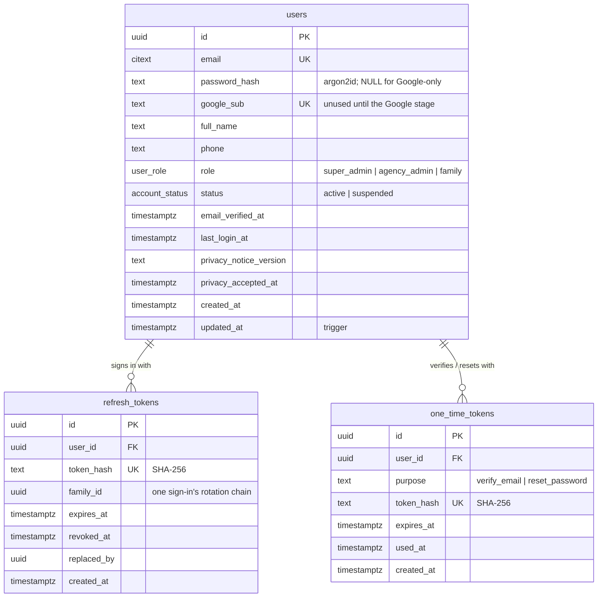

# Database

PostgreSQL 16. Migrations in `apps/api/app/db/migrations/versions/`, with readable SQL copies in `apps/api/app/db/sql/`. Conventions and the full planned schema are in `.claude/skills/helpverified/references/database.md`. This file shows **what exists now** and is updated with every migration.

| Migration | Milestone | Adds |
| --- | --- | --- |
| `0001` baseline | B1 | Extensions `pgcrypto` and `citext`; `set_updated_at()` trigger function |
| `0002` identity | B2 | `user_role`, `account_status` enums; `users`, `refresh_tokens`, `one_time_tokens` |

## Entity-relationship diagram

## Rules enforced in the database

| Rule | How |
| --- | --- |
| One account per email, case-insensitive | `citext` + `uq_users_email` (repository maps it to 409 `EMAIL_TAKEN`) |
| Only token hashes stored | `token_hash` columns; raw tokens exist only in the cookie or email |
| Tokens die with their user | `ON DELETE CASCADE` on both token tables |
| `updated_at` is always current | `users_set_updated_at` trigger |

The two hard rules (listing gate, one active placement) arrive with their tables in B3 and B4.
