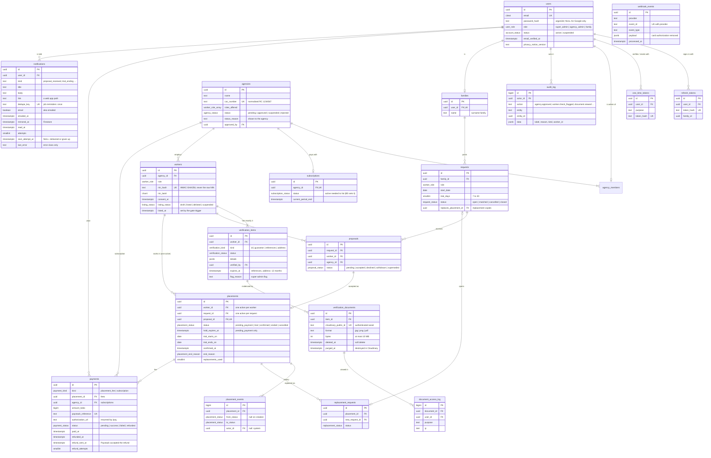

# Database

PostgreSQL 16. Migrations in `apps/api/app/db/migrations/versions/`, with readable SQL copies in `apps/api/app/db/sql/`. Conventions and the full planned schema are in `.claude/skills/helpverified/references/database.md`. This file shows **what exists now** and is updated with every migration.

| Migration | Milestone | Adds |
| --- | --- | --- |
| `0001` baseline | B1 | Extensions `pgcrypto` and `citext`; `set_updated_at()` trigger function |
| `0002` identity | B2 | `user_role`, `account_status` enums; `users`, `refresh_tokens`, `one_time_tokens` |
| `0003` agencies, workers | B3 | Six enums; `agencies`, `agency_members`, `subscriptions`, `workers`, `verification_items`, `verification_documents`, `document_access_log`, `audit_log`; **rule 1 triggers** |
| `0004` requests, placements | B4 | Five enums; `families`, `requests`, `proposals`, `placements`, `placement_events`, `replacement_requests`; **rule 2 index** |
| `0005` payments | B5 | `payment_kind`, `payment_status`; `payments`, `webhook_events` |
| `0006` notifications, jobs | B6 | `notifications`; `payments.refund_sent_at`, `refund_attempts`; `verification_documents.purged_at` |

## Entity-relationship diagram

## Rules enforced in the database

| Rule | How |
| --- | --- |
| **Rule 1: listed only with 4/4 checks verified and unexpired** | `workers_listing_gate` (BEFORE INSERT/UPDATE OF listing_status) raises `P0001`, hint `WORKER_NOT_VERIFIED`; the repository maps it to 409 |
| **Any check leaving `verified` delists the worker** | `verification_items_delist` (AFTER UPDATE OF status); active placements are not ended |
| One worker per NIN, across agencies | `uq_workers_nin_hash` (409 `DUPLICATE_WORKER`) |
| Exactly one row per check per worker | `uq_verification_items_worker_id_kind`; the four rows are created with the worker |
| A verified check names who verified it and when; a rejected one has a reason | `ck_verification_items_verified_has_verifier`, `ck_verification_items_rejected_has_reason` |
| Evidence is jpg/png/pdf, 1 byte to 10 MB | `ck_verification_documents_format`, `ck_verification_documents_bytes` |
| One account per email, case-insensitive | `citext` + `uq_users_email` |
| One agency per CAC number | `uq_agencies_cac_number` (stored normalised) |
| Only token hashes stored | `token_hash` columns |
| `updated_at` is always current | `<table>_set_updated_at` triggers |
| **Rule 2: one active placement per worker** | Partial unique index `placements_one_active_per_worker` (status in pending_payment, trial, confirmed); the accept transaction locks the worker row first; a violation maps to 409 `WORKER_UNAVAILABLE` |
| A request is filled at most once at a time | Partial unique index `placements_one_active_per_request` |
| A placement is consistent with its status | `ck_placements_hold`, `ck_placements_trial_dates`, `ck_placements_confirmed_at`, `ck_placements_end_fields` |
| One proposal per worker per request | `uq_proposals_request_id_worker_id` (a withdrawn proposal is reused when re-proposed) |
| Trials last 7 to 30 days | `ck_requests_trial_days` |
| A webhook event is processed once | `uq_webhook_events_provider_event_id` |
| One open checkout per hold | Partial unique index `payments_one_pending_fee_per_placement` |
| Money is positive integer kobo in NGN; a successful payment has a time | `ck_payments_amount`, `ck_payments_currency`, `ck_payments_paid_at` |
| A fee belongs to a placement, a subscription to an agency | `ck_payments_kind_target` |
| A notification exists exactly when its event was committed | Written in the event's own transaction; delivery (email, Firestore) runs after commit and only updates the notification's delivery columns (ADR 0015) |
| A job's reminder is written once | `uq_notifications_dedupe_key` (insert … on conflict do nothing) |
| Delivery finds due rows quickly; two runs never send one row twice | Partial index `notifications_due`; rows are leased with `FOR UPDATE SKIP LOCKED` |
